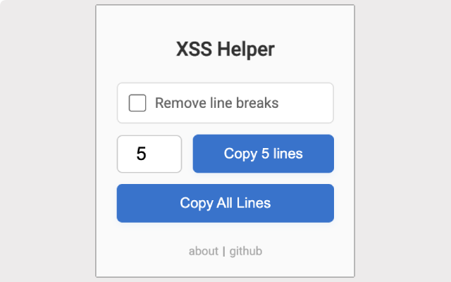
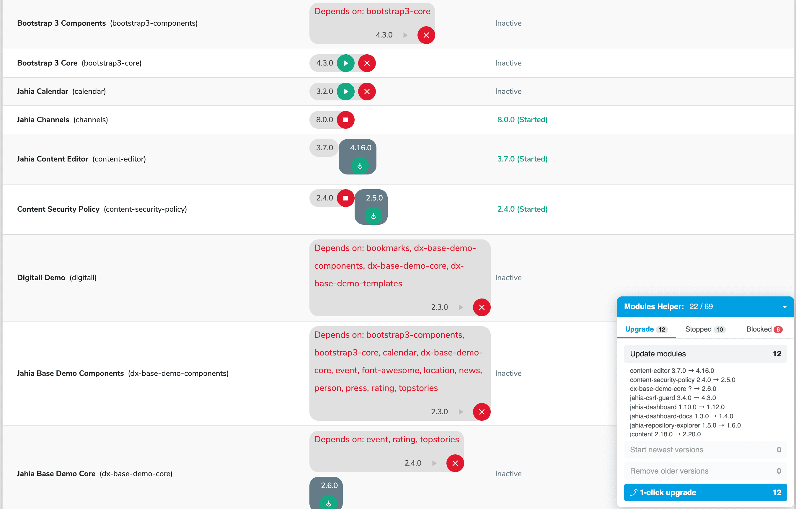

# chrome-plugins

A collection of small Chrome extensions for testing and administration tasks.

## XSS Helper

Copies random XSS payloads to the clipboard for use during security testing.

- Copy a chosen number of random payload lines, or all of them at once
- Optionally remove line breaks so the payloads paste into a single field

[Changelog](xss-helper/CHANGELOG.md) · [Privacy policy](xss-helper/PRIVACY_POLICY.md)

## Jahia Modules Helper

Adds a panel for bulk actions to the Jahia **Administration → Modules** page.

- Always shows all rows in the modules table
- Updates modules, starts the newest versions, and removes older versions
- **1-click upgrade** runs start stopped → update → start new → remove old for every module
- Starts stopped modules in bulk, and lists modules blocked by missing dependencies
- Shows the planned actions and asks for confirmation before running, and can be stopped while it runs

[Details](jahia-modules-helper/README.md) · [Changelog](jahia-modules-helper/CHANGELOG.md) · [Privacy policy](jahia-modules-helper/PRIVACY_POLICY.md)

## Installation

1. Download the extension zip from [Releases](https://github.com/x0h01/chrome-plugins/releases).
2. Open `chrome://extensions` and turn on **Developer mode**.
3. Drag and drop the zip file onto the page.

## License

[MIT](LICENSE)
